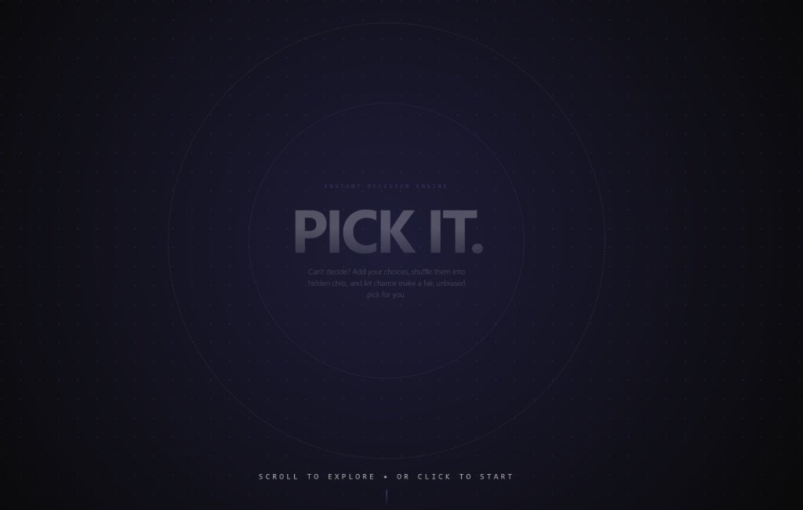

# Pick It - Decision Maker

A clean, interactive 3D web app that helps users make unbiased decisions by randomly picking from custom chits.



## Features

- **3D Perspective Tunnel**: Immersive warp sequence built with Framer Motion and camera parallax
- **Dynamic Chit Input**: Select 2–20 chits and enter custom options or load 1-click presets
- **Fisher-Yates Shuffle**: Mathematically uniform O(n) randomization powered by the Web Crypto API
- **Non-Repeating Selection**: Pick options one by one with zero duplicate bias
- **3D Card Flip Animations**: Realistic perspective card flips that conceal shuffled choices
- **Synthesized Audio Effects**: Native Web Audio API sounds for flips, cycling, and winner chimes
- **History Tracking**: Automatically saves recent decision draws in `localStorage`
- **Cross-Platform**: Optimized for mobile phones, tablets, and desktop (with keyboard shortcuts on desktop)
- **Responsive & Cosmic Theme**: Unified obsidian ether aesthetic with radial lighting

## Tech Stack

- **React 18** - UI framework
- **Vite 5** - Build tool and development server
- **Framer Motion** - 3D camera parallax & tunnel animation
- **Tailwind CSS 3** - Modern styling and animations
- **Web Crypto API** - Hardware-level entropy for unbiased shuffling
- **Web Audio API** - Zero-dependency audio synthesizer

## Getting Started

### Prerequisites

- Node.js 18+
- npm or yarn

### Installation

```bash
# Install dependencies
npm install

# Start development server
npm run dev
```

### Build for Production

```bash
npm run build
npm run preview
```

## Usage

1. **Scroll or Tap** through the 3D tunnel to enter Pick It.
2. **Choose a Preset or Select Count**: Pick a quick preset matrix or use the slider for 2–20 options.
3. **Enter Options**: Fill in each option card with your choices.
4. **Shuffle**: Click "Shuffle" to conceal and randomize choices with 3D flip animation.
5. **Pick**: Tap or click "Pick One" (or press <kbd>Space</kbd> on desktop) to draw a winner.
6. **Reset / Menu**: Click "Reset" to replay with the same choices, or "Back to Menu" to create a new board.

## License

MIT License - Feel free to use this project for your own purposes.
